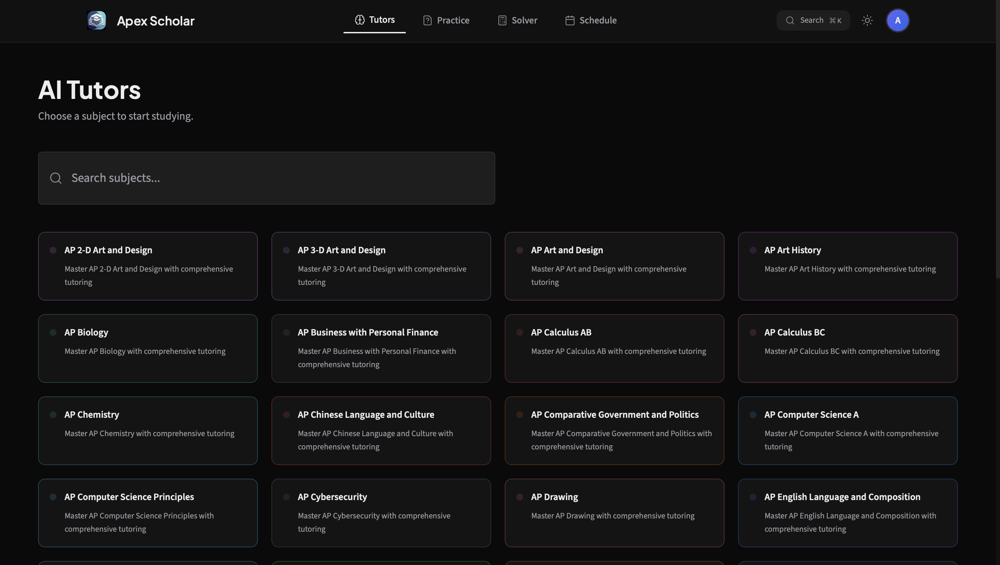

# Apex Scholar
Apex Scholar is a free website that uses AI to help students self study for their AP classes.

You can try it at **[apex-scholar.com](https://apex-scholar.com)**.

## Features

Apex Scholar has many features, including:
- AI tutors trained on their respective curriculums
- AI-generate practice tests
- A learn section that allows students to learn at their own pace
- Flashcards
- Diagnostics
- AP score calculators for each subject
- Progress
- Classes
- A scheduler for your homework and tests, which can import due dates from your Schoology or Canvas calendar

## How to run it yourself

1. git clone https://github.com/AnvithPothula/apex-scholar.git
2. cd apex-scholar/ap-prep-hub
3. npm ci (needs npm 11)
4. cp .env.example .env (fill in Firebase web config)
5. npm start

The lockfile was written by npm 11. With npm 10 (the version bundled with Node 20 and 22), "npm ci" refuses to install and reports that package.json and package-lock.json are out of sync. They aren't; npm 10 just reads the lockfile differently. Run "npm install -g npm@11" first, or use "npx npm@11 ci".

### Running with serverless functions
"npm start" runs ai-proxy, cors-proxy, class-record-test, schoology-oauth and admin-stats itself (src/setupProxy.js), reading their server-side secrets (GEMINI_API_KEYS, app tokens) from .env, so AI, calendar feeds and class leaderboards work in plain dev with no keys in the browser bundle. The email functions are left out on purpose (a dev click could send real mail). To do them locally, run Netlify Dev from the repository root (not from ap-prep-hub — the base in netlify.toml is relative to the root and will double up):

- cd apex-scholar && netlify dev

## How it works

- **Frontend:** React 18 (Create React App), Tailwind CSS with design tokens, Framer Motion
- **Auth/DB:** Firebase Auth + Firestore (rules in firestore.rules)
- **AI:** Google Gemini via a server-side proxy — a Cloudflare Worker (ai.apex-scholar.com)
  with the Netlify function ai-proxy as fallback. This is optional, but a student can connect their own Puter account to pick Puter models.
- **Hosting/serverless:** Netlify (netlify/functions/)
- **Email:** Cloudflare Email Routing inbound, SMTP2GO outbound.
- **Analytics:** Google Analytics